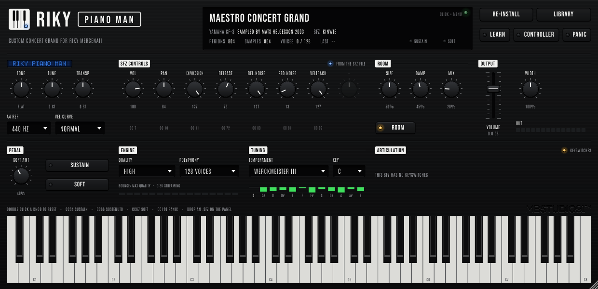

# Riky Piano Man

Pianoforte a coda personalizzato per Riky Mercenati, in formato VST3, AU (Mac) e applicazione autonoma per Mac e Windows. La grafica è quella dei plugin MBStudio91 come Campione: telaio nero, scritte bianche, colore solo nei LED, con il marchio RIKY PIANO MAN.



Il suono è il **Maestro Concert Grand** di Mats Helgesson: uno Yamaha CF-3 dei primi anni '90 campionato nota per nota nel 2003 con una coppia di Neumann KM84 in X/Y, 5 strati di velocity, campioni di rilascio dei tasti e rumori dei pedali. La versione SFZ è di kinwie e sta nel repository [sfzinstruments/MatsHelgesson.MaestroConcertGrandPiano](https://github.com/sfzinstruments/MatsHelgesson.MaestroConcertGrandPiano). Il file SFZ viene suonato così com'è dal motore [sfizz](https://github.com/sfztools/sfizz) 1.2.3, che legge i campioni dal disco.

## Scaricare

Ogni aggiornamento del ramo `main` viene compilato da GitHub Actions. I file pronti sono nella pagina **Releases**:

- `RikyPianoMan-VST3-mac.zip`, `RikyPianoMan-AU-mac.zip`, `RikyPianoMan-App-mac.zip` per Mac (Intel e Apple Silicon, macOS 11 o successivo)
- `RikyPianoMan-VST3-win.zip`, `RikyPianoMan-App-win.zip` per Windows a 64 bit

Il plugin per Mac non è firmato da Apple. Dopo averlo copiato serve questo comando nel Terminale:

```
xattr -dr com.apple.quarantine ~/Library/Audio/Plug-Ins/VST3/"Riky Piano Man.vst3" ~/Library/Audio/Plug-Ins/Components/"Riky Piano Man.component" /Applications/"Riky Piano Man.app"
```

## Primo avvio: il suono

I campioni non sono dentro il plugin. Al primo avvio il display dice PIANO NOT INSTALLED: si preme **INSTALL** e il plugin scarica una volta sola circa 256 MB dal repository ufficiale (versione fissata al commit `717078b`), li controlla e li mette in:

- Mac: `~/Music/Riky Piano Man/Maestro Concert Grand`
- Windows: `Musica\Riky Piano Man\Maestro Concert Grand`

I file restano identici agli originali, compreso `mcgreadme.txt` con le note dell'autore. Se i campioni sono già in un'altra cartella basta premere **FOLDER** e scegliere `Maestro Concert Grand.sfz`, oppure trascinare il file o la cartella sul pannello. La scelta vale per tutte le istanze e per l'app.

## Come si usa

| Sezione | Controlli |
|---|---|
| PIANO | TONE (inclinazione ±9 dB, 250 Hz e 2,5 kHz), TUNE (±50 centesimi), TRANSP (±12 semitoni), A4 REF (440 o 432 Hz), VEL CURVE (NORMAL, SOFT, HARD, FIXED) |
| SFZ CONTROLS | Fino a 8 manopole che prendono nome e valore iniziale dal file caricato (`label_cc`, `set_cc`, `set_hdcc`). Con il Maestro sono Vol, Pan, Expression, Release, Rel.Noise, Ped.Noise e Veltrack. Sono automatizzabili e seguono anche i CC che arrivano dalla tastiera |
| ROOM | Riverbero: SIZE, DAMP, MIX, acceso o spento |
| OUTPUT | VOLUME, WIDTH (larghezza stereo mid/side, 100% come registrato) e LED meter |
| PEDAL | SOFT AMT, SUSTAIN (anche CC 64, con il rumore del pedale), SOFT una corda (anche CC 67). Il sostenuto arriva dal CC 66 |
| ENGINE | QUALITY del ricampionamento dal vivo: STANDARD (Hermite), HIGH (sinc a 12 punti), ULTRA (la massima di sfizz). Nei bounce il motore usa sempre la massima e aspetta i campioni dal disco. POLYPHONY 64, 128 o 256 voci, con i LED delle voci in uso |
| TUNING | Temperamenti storici con tonica a scelta: equabile, Werckmeister III, Vallotti, Kirnberger III, mesotonico 1/4 di comma, pitagorico, naturale. Le barre mostrano lo scarto di ogni nota dall'equabile |
| ARTICULATION | I keyswitch del file (`sw_last`, `sw_label`) come pulsanti; il keyswitch attivo si accende anche sulla tastiera |

La tastiera si adatta allo strumento: i tasti che non suonano sono grigi, i keyswitch ambra. Il display mostra regioni, campioni, voci, ultima nota (con il nome del tasto se il file lo dichiara) e articolazione.

## Altri strumenti SFZ

Riky Piano Man suona qualsiasi file SFZ, non solo il Maestro. LIBRARY apre gli strumenti recenti, tutti i `.sfz` nella cartella Musica/Riky Piano Man (basta copiarci dentro le cartelle degli strumenti) e la scelta di un altro file. Si può anche trascinare un `.sfz` o la sua cartella sul pannello. Il motore sfizz gestisce le intestazioni e gli opcode SFZ v1, v2 e ARIA che usano gli strumenti pubblicati: `#define`, `#include`, keyswitch, round robin, regioni di rilascio, CC e curve, filtri, inviluppi, effetti, accordature Scala. Tempo, metro e posizione dell'host arrivano allo strumento per gli SFZ che li usano.

Un clic sul display apre il menu: cartella dei campioni, readme dell'autore, ricarica, altro file SFZ. PANIC spegne subito tutte le note. LEARN e CONTROLLER fanno il MIDI Learn su qualsiasi controllo e caricano i profili dei controller (Novation, M-Audio, AKAI, Push 2), come negli altri plugin MBStudio91. Il banco A dei profili porta gli 8 SFZ CONTROLS sulle manopole del controller.

## Note sul suono

- L'intonazione è quella della registrazione: al centro della tastiera il pianoforte sta circa 3 centesimi sotto il La 440, il La4 è registrato a circa 438 Hz, gli acuti salgono come in ogni pianoforte accordato per orecchio. Chi vuole spostare tutto usa TUNE.
- Il pedale una corda del file originale è solo un rumore meccanico (il "Lid" sul CC 67); l'abbassamento della dinamica con SOFT AMT è del plugin.
- Il primo caricamento legge 804 regioni e richiede pochi secondi; la memoria occupata resta bassa perché i campioni vengono letti dal disco.
- Con un temperamento il La resta al diapason scelto (440 o 432) e le altre note si spostano: con Werckmeister III in Do, il Do sale di circa 12 centesimi rispetto all'equabile e il Mi sta circa 10 centesimi sotto il Do. È il modo in cui sfizz applica le scale Scala.
- Valori dei temperamenti: Werckmeister III e Kirnberger III dalle tabelle di Wikipedia, Vallotti dagli scarti indicati su Wikipedia riportati a Do; mesotonico, pitagorico e naturale calcolati dai rapporti.

## Licenze e crediti

- Codice di Riky Piano Man: AGPL v3 (vedi `LICENSE.md`), derivato da MBStudio91 Campione.
- sfizz: licenza BSD a 2 clausole, © sfizz contributors.
- JUCE: licenza AGPL v3.
- Font Bebas Neue e Antonio: SIL Open Font License (cartella `MBStudioUI/fonts`).
- Campioni: © Mats Helgesson 2003, tutti i diritti riservati. Il set è gratuito e **non si può vendere**, né modificare e ridistribuire senza il permesso scritto dell'autore. Per questo il plugin non li contiene e li scarica invariati dalla fonte ufficiale. Strumento SFZ derivato da [sfzinstruments/MatsHelgesson.MaestroConcertGrandPiano](https://github.com/sfzinstruments/MatsHelgesson.MaestroConcertGrandPiano), conversione di kinwie pubblicata con il permesso dell'autore.

## Compilare in proprio

```
cmake -S . -B build -DCMAKE_BUILD_TYPE=Release
cmake --build build --config Release
```

JUCE 9.0.5 e sfizz 1.2.3 vengono scaricati da CMake. Sul Mac si compila un'architettura per volta (`-DCMAKE_OSX_ARCHITECTURES=x86_64` oppure `arm64`); il workflow le unisce con `lipo`. Per la prova del motore senza interfaccia:

```
cmake -S . -B build -DRIKY_BUILD_TOOLS=ON
cmake --build build --target riky_render
./build/riky_render_artefacts/Release/riky_render "percorso/Maestro Concert Grand.sfz" prova.wav tools/test-instrument/keyswitch-test.sfz
```

La prova controlla il caricamento delle 804 regioni, i tasti e i controlli letti dal file con i loro valori iniziali, l'intonazione rispetto alla registrazione, 432 Hz, TUNE e trasposizione, gli strati di velocity, il sustain da CC 64 e dal pannello, il rumore di rilascio dei tasti, tutti gli 88 tasti, PANIC, l'assenza di note bloccate, i temperamenti con la tonica, gli SFZ CONTROLS, i tre livelli di qualità e, con lo strumento di prova in `tools/test-instrument`, keyswitch, nomi delle articolazioni e trasposizione che non sposta i keyswitch. Gira anche su GitHub a ogni commit.
