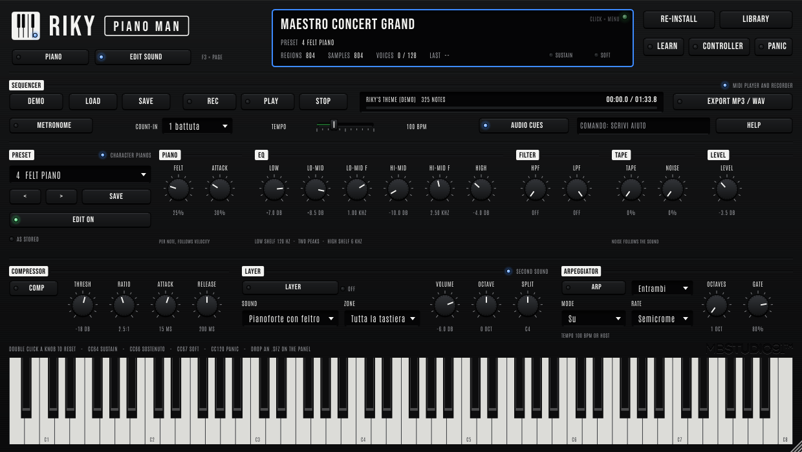

# Riky Piano Man

Pianoforte a coda personalizzato per Riky Mercenati, in formato VST3, AU (Mac) e applicazione autonoma per Mac e Windows. La grafica è quella dei plugin MBStudio91 come Campione: telaio nero, scritte bianche, colore solo nei LED, con il marchio RIKY PIANO MAN.


Il suono è il **Maestro Concert Grand** di Mats Helgesson: uno Yamaha CF-3 dei primi anni '90 campionato nota per nota nel 2003 con una coppia di Neumann KM84 in X/Y, 5 strati di velocity, campioni di rilascio dei tasti e rumori dei pedali. La versione SFZ è di kinwie e sta nel repository [sfzinstruments/MatsHelgesson.MaestroConcertGrandPiano](https://github.com/sfzinstruments/MatsHelgesson.MaestroConcertGrandPiano). Il file SFZ viene suonato così com'è dal motore [sfizz](https://github.com/sfztools/sfizz) 1.2.3, che legge i campioni dal disco.

## Scaricare

Ogni aggiornamento del ramo `main` viene compilato da GitHub Actions. I file pronti sono nella pagina **Releases**:

- `RikyPianoMan-VST3-mac.zip`, `RikyPianoMan-AU-mac.zip`, `RikyPianoMan-App-mac.zip` per Mac (Intel e Apple Silicon, macOS 11 o successivo)
- `RikyPianoMan-VST3-win.zip`, `RikyPianoMan-App-win.zip` per Windows a 64 bit

Il plugin per Mac non è firmato da Apple. Dopo averlo copiato serve questo comando nel Terminale:

```
xattr -dr com.apple.quarantine ~/Library/Audio/Plug-Ins/VST3/"Riky Piano Man.vst3" ~/Library/Audio/Plug-Ins/Components/"Riky Piano Man.component" /Applications/"Riky Piano Man.app"
```

## Primo avvio: il suono

I campioni non sono dentro il plugin. Al primo avvio il display dice PIANO NOT INSTALLED: si preme **INSTALL** e il plugin scarica una volta sola circa 256 MB dal repository ufficiale (versione fissata al commit `717078b`), li controlla e li mette in:

- Mac: `~/Music/Riky Piano Man/Maestro Concert Grand`
- Windows: `Musica\Riky Piano Man\Maestro Concert Grand`

I file restano identici agli originali, compreso `mcgreadme.txt` con le note dell'autore. Se i campioni sono già in un'altra cartella basta premere **FOLDER** e scegliere `Maestro Concert Grand.sfz`, oppure trascinare il file o la cartella sul pannello. La scelta vale per tutte le istanze e per l'app.

## Come si usa

| Sezione | Controlli |
|---|---|
| PIANO | TONE (inclinazione ±9 dB, 250 Hz e 2,5 kHz), TUNE (±50 centesimi), TRANSP (±12 semitoni), A4 REF (440 o 432 Hz), VEL CURVE (NORMAL, SOFT, HARD, FIXED) |
| SFZ CONTROLS | Fino a 8 manopole che prendono nome e valore iniziale dal file caricato (`label_cc`, `set_cc`, `set_hdcc`). Con il Maestro sono Vol, Pan, Expression, Release, Rel.Noise, Ped.Noise e Veltrack. Sono automatizzabili e seguono anche i CC che arrivano dalla tastiera |
| ROOM | Riverbero: SIZE, DAMP, MIX, acceso o spento |
| OUTPUT | VOLUME, WIDTH (larghezza stereo mid/side, 100% come registrato) e LED meter |
| PEDAL | SOFT AMT, SUSTAIN (anche CC 64, con il rumore del pedale), SOFT una corda (anche CC 67). Il sostenuto arriva dal CC 66 |
| ENGINE | QUALITY del ricampionamento dal vivo: STANDARD (Hermite), HIGH (sinc a 12 punti), ULTRA (la massima di sfizz). Nei bounce il motore usa sempre la massima e aspetta i campioni dal disco. POLYPHONY 64, 128 o 256 voci, con i LED delle voci in uso |
| TUNING | Temperamenti storici con tonica a scelta: equabile, Werckmeister III, Vallotti, Kirnberger III, mesotonico 1/4 di comma, pitagorico, naturale. Le barre mostrano lo scarto di ogni nota dall'equabile |
| ARTICULATION | I keyswitch del file (`sw_last`, `sw_label`) come pulsanti; il keyswitch attivo si accende anche sulla tastiera |

Il pannello ha due pagine: PIANO (quella descritta qui sopra) ed EDIT SOUND, con i pulsanti sotto il marchio o con F3.

## Pagina EDIT SOUND: suono su misura e preset



| Sezione | Controlli |
|---|---|
| PRESET | Menu con 17 preset di fabbrica e quelli salvati, precedente e successivo (F7, F8), SAVE, EDIT ON (esclude tutta la pagina per il confronto). Gli stessi preset sono i programmi dell'host e rispondono al Program Change MIDI |
| PIANO | FELT: un passa-basso su ogni nota che segue la dinamica, aggiunto dentro lo strumento SFZ (CC interni 300 e 301, il file sul disco resta com'è). ATTACK: attacco più lento |
| EQ | LOW (scaffale a 120 Hz), LO-MID e HI-MID con la loro frequenza, HIGH (scaffale a 6 kHz), ±12 dB |
| FILTER | HPF 20–600 Hz e LPF 1–20 kHz, spenti agli estremi |
| TAPE | Saturazione asimmetrica a guadagno unitario sui segnali piccoli, rigonfiamento a 80 Hz e acuti più morbidi; NOISE è un fruscio che segue il suono e sparisce nel silenzio |
| LEVEL | Livello dopo le modifiche: i preset lo usano per suonare forti come il Maestro |
| COMPRESSOR | Soglia, rapporto, attacco, rilascio, ginocchio morbido e compensazione automatica |
| LAYER | Secondo strato con un suono interno (piano elettrico FM, piano elettrico a lamelle, pad caldo, pad sintetico, ottoni FM, pad di feltro, basso sintetico) o il pianoforte stesso con il feltro; volume, ottava, zona (tutta la tastiera, sotto o sopra lo split) e nota di split |
| ARPEGGIATOR | Su, giù, su e giù, casuale, come suonate, accordo; da 1/4 a 1/32 con terzine, 1–4 ottave, gate; su entrambi gli strati o su uno solo. Va al tempo del sequencer o dell'host |

I preset imitano il colore delle 16 Performance "Character Pianos" di Yamaha Montage partendo dal Maestro, senza campioni Yamaha. Sono stati misurati sul video dimostrativo e tarati esportando dal plugin: metodo, numeri e limiti sono in [docs/PRESET-CHARACTER-PIANOS.md](docs/PRESET-CHARACTER-PIANOS.md), gli script in `tools/calibration`. In ogni release `RikyPianoMan-preset-Character-Pianos.mp3` fa sentire i 17 preset sullo stesso passaggio di "Riky's Theme".

Tutto quello che si sente nella pagina finisce anche negli export: la catena e l'arpeggio sono gli stessi. Il sequencer registra le note suonate prima dell'arpeggio, così un brano registrato con l'arpeggio si riascolta uguale.

La tastiera si adatta allo strumento: i tasti che non suonano sono grigi, i keyswitch ambra. Il display mostra regioni, campioni, voci, ultima nota (con il nome del tasto se il file lo dichiara) e articolazione.

## Accessibilità: pensato per Riky, che non vede

Riky usa Windows con lettore di schermo e una barra braille Humanware Brailliant BI 40X. Riky Piano Man si usa per intero con NVDA, JAWS o Assistente vocale (e con VoiceOver sul Mac) e con la sola tastiera.

- **Installer per Windows** (`RikyPianoMan-Setup-win.exe`, Inno Setup in italiano): procedura guidata con finestre standard di Windows, installa app, VST3, guida e collegamenti nel menu Start e sul desktop.
- **Annunci come notifiche UI Automation** su Windows: la libreria JUCE di suo li farebbe dire alla voce SAPI di Windows, sopra NVDA o JAWS e senza braille; qui vanno al lettore di schermo con `UiaRaiseNotificationEvent` (Windows 10 1709 o successivo), quindi voce del lettore e barra braille.
- **Scorciatoie con Ctrl** su Windows (Comando sul Mac) e finestra Audio e MIDI con Ctrl virgola o con il comando `audio`. La guida completa, scritta per essere letta riga per riga, è [docs/GUIDA-RIKY.txt](docs/GUIDA-RIKY.txt); il pulsante HELP (o F1) la apre e legge a voce l'elenco dei comandi.

- **Nomi e aiuti in italiano** per ogni controllo, con valori detti per esteso ("meno 3 decibel", "100 battiti al minuto", "più 2 semitoni"). I controlli dello strumento prendono il nome scritto nel file SFZ.
- **Gruppi e ordine di Tab** pensati per l'uso: stato del pianoforte, pagine, sequencer, poi i gruppi della pagina aperta (pianoforte: suono, pedali, controlli dello strumento, articolazioni, stanza, uscita, motore, accordatura; modifica: preset, feltro e attacco, equalizzatore, filtri, nastro, livello, compressore, secondo strato, arpeggiatore), controller MIDI. All'apertura il fuoco è sul display dello stato, che si legge come testo; anche lo stato del brano è un testo che si legge con Tab.
- **Annunci parlati** di quello che cambia: pianoforte pronto, download ogni 10%, riproduzione, conteggio, registrazione, fine della registrazione con numero di note e durata, export ogni 25% e alla fine con nome del file e picco, articolazioni, assegnazioni MIDI.
- **Scorciatoie**: spazio o F5 suona e ferma, R o F6 registra, S ferma, D demo, Esc panic, I o F2 legge lo stato, M metronomo, C conteggio, più e meno il tempo (Pagina su e giù di dieci), Comando O apri MIDI, Comando S salva, Comando E esporta subito in MP3 senza finestre, Comando Maiuscole E in WAV, Comando L libreria, Comando M assegna al controller MIDI il controllo che ha il fuoco.
- **Segnali sonori** che non servono lo schermo: due note che salgono quando la registrazione parte, due che scendono quando finisce, tre quando l'export è pronto, due gravi per un errore. Conteggio e metronomo a click, il primo della battuta più acuto. Non finiscono nelle registrazioni né negli export.
- **Barra braille** (Riky usa una Humanware Brailliant BI 40X a 40 celle): testi brevi con l'informazione nelle prime celle ("Pronto: Maestro Concert Grand", "Suona 0:12 di 1:34, Riky's Theme") e un **campo Comando** in cui si scrive con la tastiera braille: `suona`, `ferma`, `registra`, `demo`, `esporta`, `stato`, `tempo 90`, `metronomo`, `conteggio 1`, `volume -6`, `trasponi 2`, `accorda 10`, `diapason 432`, `panic`, `guida`, `aiuto`, e per il suono `preset 4`, `preset felt`, `elenco`, `modifica`, `feltro 40`, `nastro 30`, `strato si`, `arpeggio si`, `split 60`, `salva preset nome`.
- **Trasporto dal controller MIDI**: PLAY, STOP e REC funzionano con i tasti MMC (MIDI Machine Control) dei controller che li hanno, oppure si assegnano a qualsiasi tasto con Comando M sul pulsante.
- **Finestre del sistema** per conferme e file, che i lettori di schermo conoscono già; pulsanti che non si spengono e LED che non lampeggiano, per non far perdere il fuoco o riempire di annunci.
- Disposizione: il sequencer è subito sotto il display, dove si usa di più; per chi aiuta guardando lo schermo il controllo con il fuoco ha un bordo blu.

- **Preset** con F7 e F8 o con il Program Change del controller: il nome viene detto con una frase che descrive il suono, e "modificato" se un controllo è stato cambiato.

La prova `--a11y` dell'app autonoma scrive l'albero di accessibilità come lo vede un lettore di schermo (pagina pianoforte e pagina modifica, 73 elementi nella seconda, tutti con un nome).

## Sequencer: demo, registrazione, export

La fila SEQUENCER è un lettore e registratore MIDI a una traccia.

- **DEMO** carica e suona "Riky's Theme", un brano originale scritto per questo pianoforte (Mib maggiore, 72 BPM, circa un minuto e mezzo, con pedale e dinamiche). Lo genera `tools/make_demo.py`, il file è `Resources/demo-riky-theme.mid` ed è incorporato nel plugin.
- **LOAD** apre un file MIDI (.mid); tutte le tracce vengono unite e suonate sul pianoforte.
- **REC** registra quello che si suona: tastiera MIDI, tastiera del pannello, pulsanti dei keyswitch e pulsante SUSTAIN (come CC 64). **STOP** chiude la ripresa e le note ancora tenute vengono chiuse. Una nuova ripresa sostituisce quella in memoria.
- **COUNT-IN**, **METRONOME** e **TEMPO**: conteggio di 1 o 2 battute prima di registrare e click durante la registrazione. Con conteggio o metronomo la ripresa resta a tempo e il file MIDI salvato ha quel tempo; senza, il silenzio iniziale viene tolto.
- **PLAY** e **STOP** suonano e fermano il brano; la tastiera del pannello mostra le note.
- **SAVE** salva il brano come file MIDI in Musica/Riky Piano Man/Songs.
- **EXPORT MP3 / WAV** fa il render fuori tempo reale, alla qualità massima e a 44,1 kHz (la frequenza dei campioni del Maestro, quindi senza ricampionamento), con la stessa catena del pannello (tono, larghezza, stanza, volume). Formati: MP3 320 kbps, MP3 V0, WAV 24 bit. I file vanno in Musica/Riky Piano Man/Exports; un clic sul riquadro del brano apre la cartella. Alla fine il riquadro mostra il picco in dBFS e avvisa se c'è clipping.

Il brano resta salvato nel progetto della DAW o nelle impostazioni dell'app. L'MP3 è codificato con LAME 3.100 (LGPL), compilato dai sorgenti ufficiali controllati con l'impronta SHA-256; ha tag ID3 e l'intestazione LAME, così i lettori conoscono la durata esatta.

## Altri strumenti SFZ

Riky Piano Man suona qualsiasi file SFZ, non solo il Maestro. LIBRARY apre gli strumenti recenti, tutti i `.sfz` nella cartella Musica/Riky Piano Man (basta copiarci dentro le cartelle degli strumenti) e la scelta di un altro file. Si può anche trascinare un `.sfz` o la sua cartella sul pannello. Il motore sfizz gestisce le intestazioni e gli opcode SFZ v1, v2 e ARIA che usano gli strumenti pubblicati: `#define`, `#include`, keyswitch, round robin, regioni di rilascio, CC e curve, filtri, inviluppi, effetti, accordature Scala. Tempo, metro e posizione dell'host arrivano allo strumento per gli SFZ che li usano.

Un clic sul display apre il menu: cartella dei campioni, readme dell'autore, ricarica, altro file SFZ. PANIC spegne subito tutte le note. LEARN e CONTROLLER fanno il MIDI Learn su qualsiasi controllo e caricano i profili dei controller (Novation, M-Audio, AKAI, Push 2), come negli altri plugin MBStudio91. Il banco A dei profili porta gli 8 SFZ CONTROLS sulle manopole del controller.

## Note sul suono

- L'intonazione è quella della registrazione: al centro della tastiera il pianoforte sta circa 3 centesimi sotto il La 440, il La4 è registrato a circa 438 Hz, gli acuti salgono come in ogni pianoforte accordato per orecchio. Chi vuole spostare tutto usa TUNE.
- Il pedale una corda del file originale è solo un rumore meccanico (il "Lid" sul CC 67); l'abbassamento della dinamica con SOFT AMT è del plugin.
- Il primo caricamento legge 804 regioni e richiede pochi secondi; la memoria occupata resta bassa perché i campioni vengono letti dal disco.
- Con un temperamento il La resta al diapason scelto (440 o 432) e le altre note si spostano: con Werckmeister III in Do, il Do sale di circa 12 centesimi rispetto all'equabile e il Mi sta circa 10 centesimi sotto il Do. È il modo in cui sfizz applica le scale Scala.
- Valori dei temperamenti: Werckmeister III e Kirnberger III dalle tabelle di Wikipedia, Vallotti dagli scarti indicati su Wikipedia riportati a Do; mesotonico, pitagorico e naturale calcolati dai rapporti.

## Licenze e crediti

- Codice di Riky Piano Man: AGPL v3 (vedi `LICENSE.md`), derivato da MBStudio91 Campione.
- sfizz: licenza BSD a 2 clausole, © sfizz contributors. Con una correzione (`cmake/patch-sfizz.cmake`) per il render fuori tempo reale: sfizz 1.2.3 non aspettava i file ancora in coda e ogni tanto la prima parte di una nota esportata restava muta (5 caricamenti su 108 nella prova, nessuno su 108 dopo la correzione).
- LAME 3.100: licenza LGPL 2, © The LAME Project (codifica MP3).
- Demo "Riky's Theme": brano originale scritto per Riky Piano Man, stessa licenza del progetto.
- Suoni del secondo strato: strumenti SFZ originali scritti per Riky Piano Man (oscillatori di sfizz), stessa licenza del progetto.
- Preset Character Pianos: imitazioni del colore, nessun campione Yamaha. Yamaha, Montage e MODX sono marchi di Yamaha Corporation; i nomi delle Performance servono solo a dire quale suono si imita.
- JUCE: licenza AGPL v3.
- Font Bebas Neue e Antonio: SIL Open Font License (cartella `MBStudioUI/fonts`).
- Campioni: © Mats Helgesson 2003, tutti i diritti riservati. Il set è gratuito e **non si può vendere**, né modificare e ridistribuire senza il permesso scritto dell'autore. Per questo il plugin non li contiene e li scarica invariati dalla fonte ufficiale. Strumento SFZ derivato da [sfzinstruments/MatsHelgesson.MaestroConcertGrandPiano](https://github.com/sfzinstruments/MatsHelgesson.MaestroConcertGrandPiano), conversione di kinwie pubblicata con il permesso dell'autore.

## Compilare in proprio

```
cmake -S . -B build -DCMAKE_BUILD_TYPE=Release
cmake --build build --config Release
```

JUCE 9.0.5, sfizz 1.2.3 e LAME 3.100 vengono scaricati da CMake. Sul Mac si compila un'architettura per volta (`-DCMAKE_OSX_ARCHITECTURES=x86_64` oppure `arm64`); il workflow le unisce con `lipo`. Per la prova del motore senza interfaccia:

```
cmake -S . -B build -DRIKY_BUILD_TOOLS=ON
cmake --build build --target riky_render
./build/riky_render_artefacts/Release/riky_render "percorso/Maestro Concert Grand.sfz" prova.wav tools/test-instrument/keyswitch-test.sfz export
```

La prova controlla il caricamento delle 804 regioni, i tasti e i controlli letti dal file con i loro valori iniziali, l'intonazione rispetto alla registrazione, 432 Hz, TUNE e trasposizione, gli strati di velocity, il sustain da CC 64 e dal pannello, il rumore di rilascio dei tasti, tutti gli 88 tasti, PANIC, l'assenza di note bloccate, i temperamenti con la tonica, gli SFZ CONTROLS, i tre livelli di qualità e, con lo strumento di prova in `tools/test-instrument`, keyswitch, nomi delle articolazioni e trasposizione che non sposta i keyswitch. Poi il sequencer (la demo suona, STOP rilascia note e pedale, una ripresa simulata viene chiusa e salvata in MIDI) e l'export della demo in MP3 320 e WAV 24 bit, con controllo di livello, tag e dimensione. Gira anche su GitHub a ogni commit, e l'MP3 della demo finisce nella pagina Releases.
